# Passport lab: call the Postman API without holding the key (stretch goal)

This lab runs a Passport Proxy next to the rpd-311 cluster and protects one credential, your Postman API key. You will register an API, point a secret reference at a key in Vault, approve your own access, and call `api.getpostman.com` from the Passport CLI without the key ever appearing in your shell, a file or the command.

The lab teaches Passport, not Kubernetes or Vault. A `Makefile` in this folder starts the cluster, deploys the sample app, creates the keys and Secrets, runs a throwaway Vault and installs the proxy. You do the parts that live in the Passport app and CLI.

It is separate from the API Catalog capstone in [`../api-catalog/CAPSTONE.md`](../api-catalog/CAPSTONE.md). You do not need that lab, and it does not need this one.

Tested on minikube 1.38.1 (Docker driver, Apple silicon), Passport CLI 0.9.2 and Passport chart 0.6.0, on 2026-11-23. The `Makefile` targets that touch only local files and read-only cluster state were run; a full `make up` on a fresh machine has not been run end to end.

## What the lab sets up

| Piece | Where it runs | Created by |
|---|---|---|
| The three rpd-311 services, Postgres, Redis, LocalStack | namespace `rpd311` | `make app` |
| Passport CA and reference keys | `~/passport-lab/passport-keys` (outside this repo) and Secret `passport-keys` | `make keys` |
| A throwaway HashiCorp Vault in dev mode | namespace `passport` | `make vault` |
| Your Postman API key, stored in Vault as `postman-api-key` | Vault | `make vault-secret` |
| The Passport Proxy (2 replicas) | namespace `passport` | `make registry`, `make proxy` |

Two things differ from a real deployment. Vault runs in dev mode with a fixed token and keeps data in memory. The proxy is reached through `kubectl port-forward` instead of a load balancer with a DNS name and a certificate from a certificate authority.

## Before you start

You need:

- macOS or Linux, Docker (running), `minikube`, `kubectl`, Helm 3.8 or later, `openssl` and `make`. `make check` tests for them.
- Docker Desktop with at least 8 GB of memory (Settings, Resources). The default `MEMORY=7500` for minikube must fit inside it. If `minikube start` stops with `MK_USAGE: Docker Desktop has only ...`, raise the Docker limit or pass a smaller `MEMORY=...`.
- A Passport organization you can use for the lab. Sign up at <https://app.usepassport.ai/>, then:
  1. **Org Settings > Overview**: copy the **Organization ID** (it starts with `org_`).
  2. **Org Settings > Registry > Generate credential**: copy the credential. It is shown once.
  3. **Home > Create namespace**: create a namespace called `rpd311-apis`. (Passport namespaces are groups of APIs, not Kubernetes namespaces.)
- A Postman API key for your own account.

Export the three values in the shell you will run `make` from. `read -s` keeps them out of your history and off the screen:

```bash
read -rs "PASSPORT_REGISTRY_KEY?Registry credential: " && echo && export PASSPORT_REGISTRY_KEY
read -rs "POSTMAN_API_KEY?Postman API key: " && echo && export POSTMAN_API_KEY
export PASSPORT_ORG_ID="org_..."
```

(In bash, use `read -rsp "Registry credential: " PASSPORT_REGISTRY_KEY`.) The `read` command prints nothing while you type. Press Return when you are done.

## Start everything

From the repository root:

```bash
make -C docs/passport up
```

This runs, in order: `check`, `cluster`, `app`, `keys`, `vault`, `vault-secret`, `registry` and `proxy`. It takes several minutes the first time. Every step is safe to run again, and `make -C docs/passport help` lists each one. A few pod restarts in the first minutes are normal while Postgres and LocalStack start.

Then open a second terminal and leave this running:

```bash
make -C docs/passport forward
```

It forwards the proxy's management port (8081) and proxy port (8443) to `localhost`. If it stops, run it again. Restart it after any proxy restart, because it attaches to one pod.

Check the result with `make -C docs/passport status`. It lists the pods, asks the proxy if it is ready, and tells you whether Vault still holds the Postman key.

## Register the proxy in the Passport app

In the app, open **Access proxies** and click **Create access proxy**.

| Field | Value |
|---|---|
| Proxy name | `rpd311-lab-proxy` |
| Proxy endpoint | `https://localhost:8443` |
| Management host URL | `http://localhost:8081` |
| Vault providers | Hashicorp |
| Public key | the output of `make -C docs/passport public-key` |

You cannot change the public key after you create the access proxy. Paste the whole block, including the `BEGIN` and `END` lines.

On one trial organization the **Create access proxy** button did not appear, even though the docs describe it. If yours is missing, ask the Passport team. The console is the documented route, and this lab has no supported alternative.

If your organization already has registrations, the proxy you just made should be the default. Secret references are encrypted for the default proxy, and an old default can make new references fail with `502 failed to decrypt vault reference`.

## Add the API as a resource

Open the `rpd311-apis` namespace. These captures show the Postman API being added by hand.

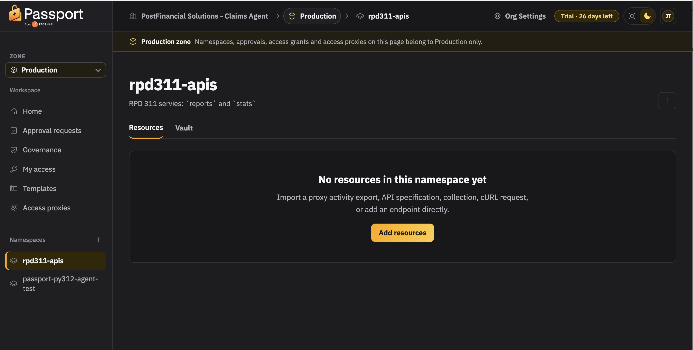

1. Open the **Resources** tab and click **Add resources**.

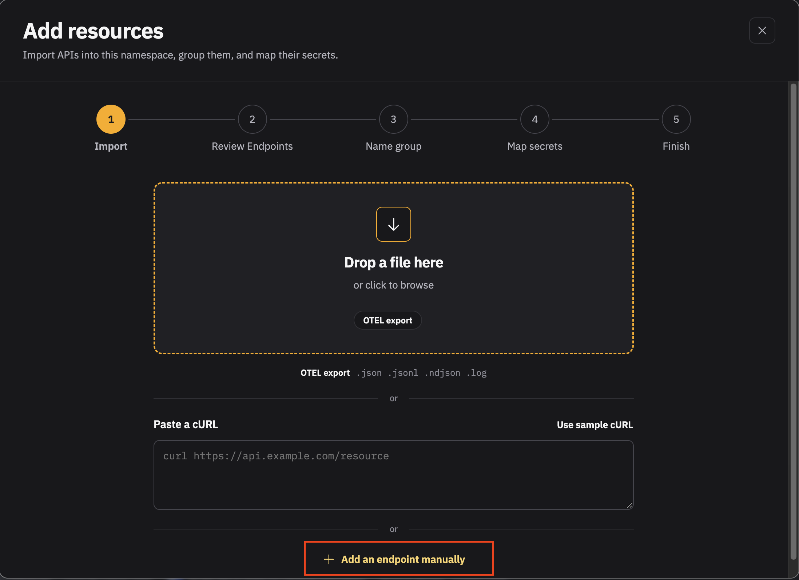

2. The wizard has five steps. Click **Add an endpoint manually**.

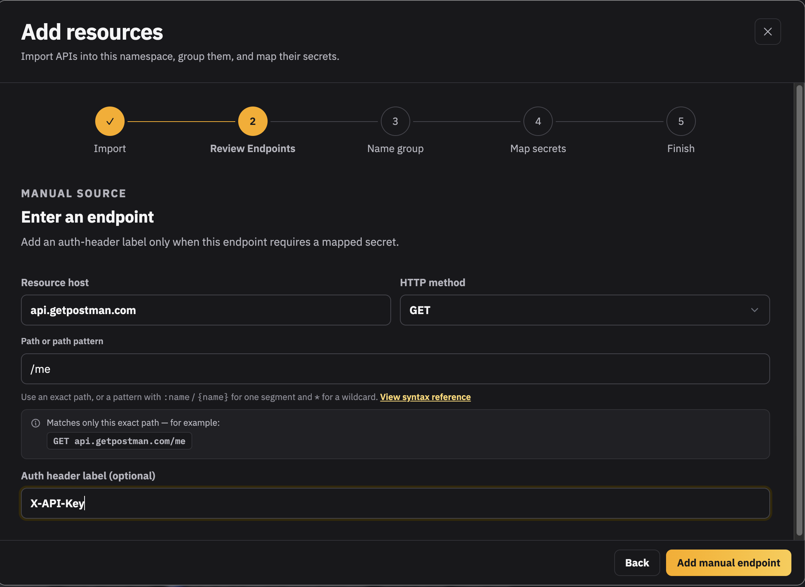

3. Fill in the form, then click **Add manual endpoint**:

   | Field | Value |
   |---|---|
   | Resource host | `api.getpostman.com` (no port) |
   | HTTP method | `GET` |
   | Path or path pattern | `/me` |
   | Auth header label | `X-API-Key` |

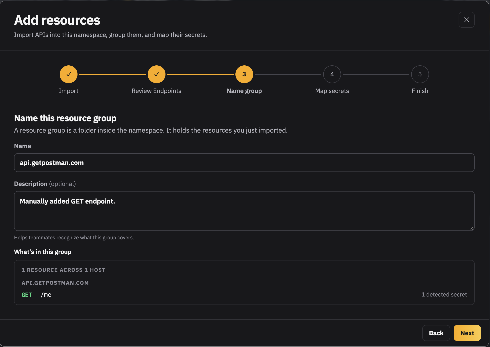

4. Name the resource group `api.getpostman.com`.

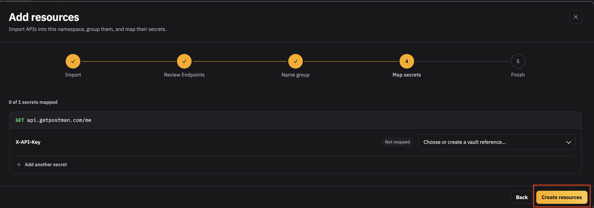

5. Leave the secret unmapped for now and click **Create resources**.

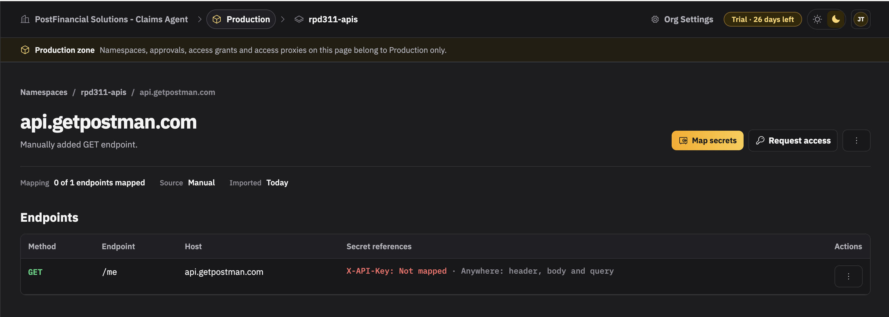

6. The group page lists the endpoint. It reads **Mapping 0 of 1 endpoints mapped** until you map a secret.

## Create the secret reference

A secret reference tells Passport which entry in your store holds the credential. It does not contain the credential.

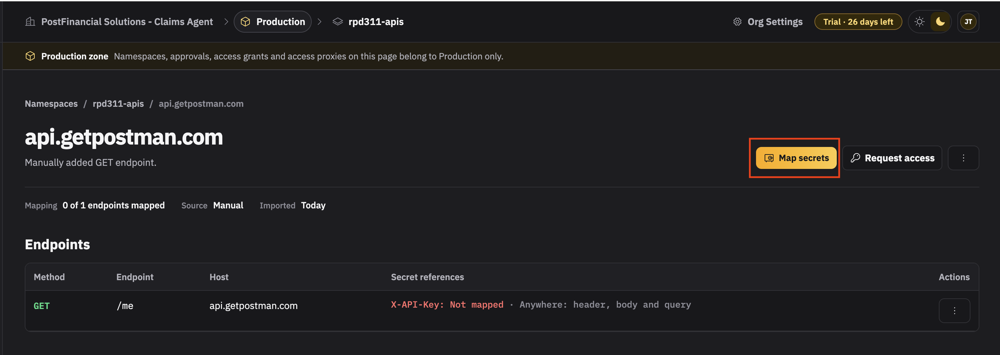

1. On the resource group page, click **Map secrets**.

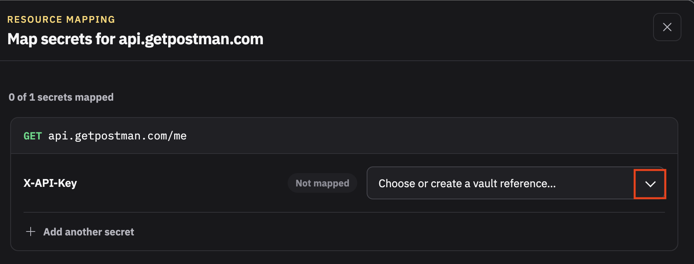

2. Open the dropdown next to `X-API-Key`.

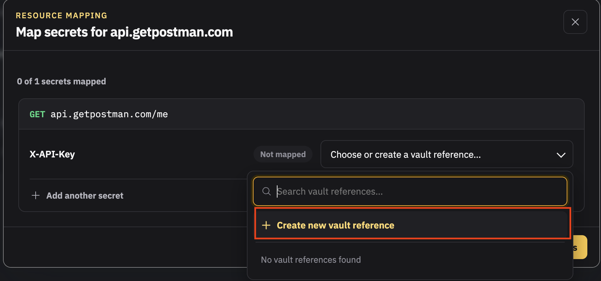

3. Choose **Create new vault reference**.

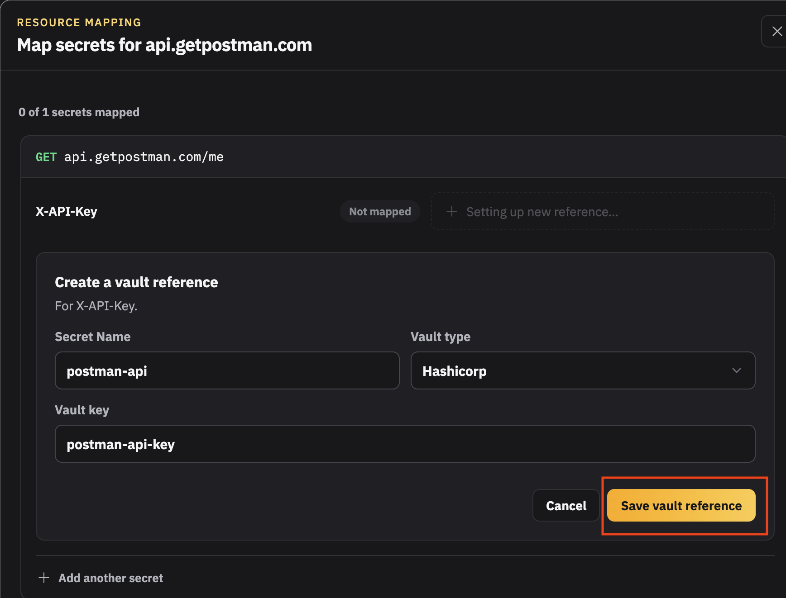

4. Fill it in, then click **Save vault reference**:

   | Field | Value |
   |---|---|
   | Secret Name | `postman-api` |
   | Vault type | Hashicorp |
   | Vault key | `postman-api-key` |

   The vault key has no `secret/` prefix. References cannot be edited or deleted in the console, so check all three values first.

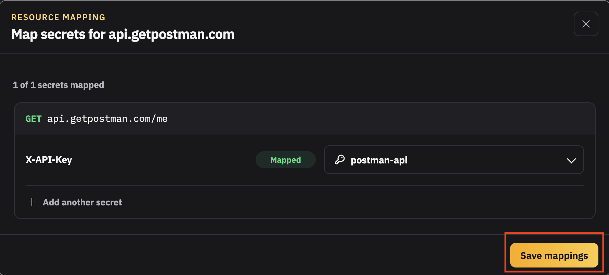

5. Click **Save mappings**. Saving the reference does not map it. This second click does.

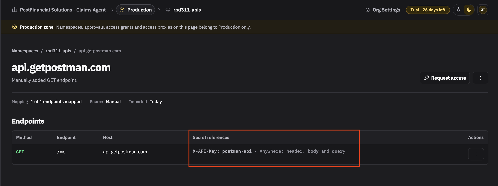

6. The group page now reads **Mapping 1 of 1 endpoints mapped**.

## Request and approve access

In this lab you are both the requester and the approver, as an organization Admin.

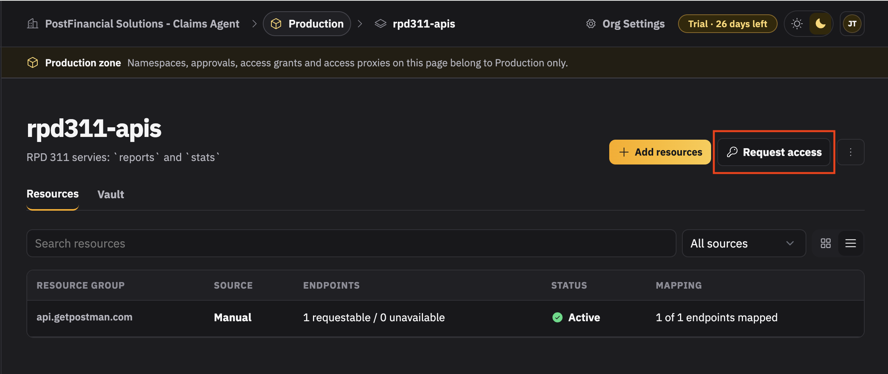

1. Open the namespace and click **Request access**.

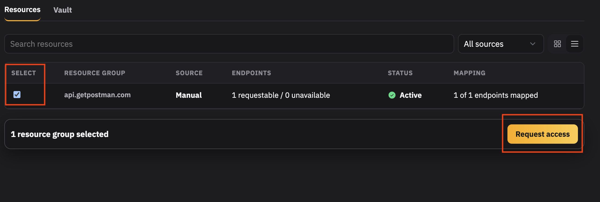

2. Tick the resource group, then click **Request access** in the bar.

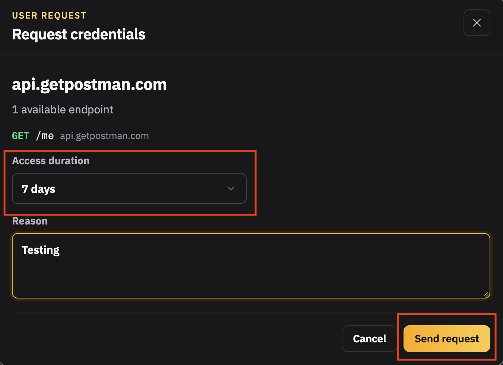

3. Choose a duration (the default is 7 days), give a reason and click **Send request**.

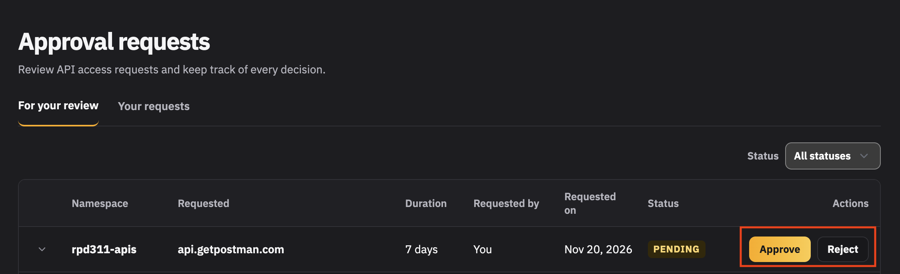

4. Open **Approval requests > For your review**. Your request is **Pending**. Click **Approve**.

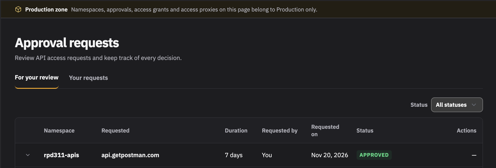

5. The status changes to **Approved**.

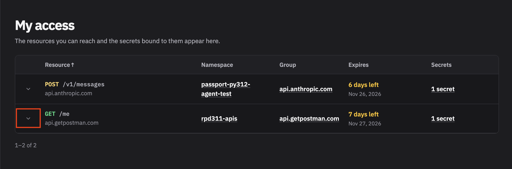

6. Open **My access** and expand the row.

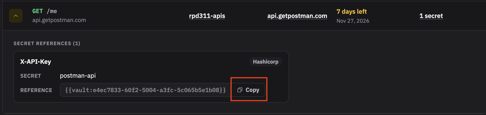

7. The expanded row shows the reference, `{{vault:<uuid>}}`. Copy it. It is a pointer, not a secret.

## Connect the Passport CLI and call the API

Install the CLI from the [Passport docs](https://docs.usepassport.ai). If you ever installed Passport CLI Community Edition, remove it first, because it also installs a command called `passport`.

```bash
passport login --no-setup
passport setup --management-url http://localhost:8081 --proxy-url https://localhost:8443 --no-daemon
```

`login` shows a confirmation code. Check that it matches the code in the browser. `http://localhost` is the one plain-HTTP management URL the CLI accepts, for local development. `setup` prints a warning that the Passport CA is not trusted by the machine. You do not need to trust it for `passport request`.

Your certificate lasts about five minutes. Refresh it, check the reference, then call the API:

```bash
passport refresh
passport whoami
passport request "https://api.getpostman.com/me" -H "X-API-Key: {{vault:<uuid-from-whoami>}}"
```

The response is your Postman account's details. No API key appears in your shell, your history or the command. Do not paste the output into a public place unredacted.

Use the UUID, not the secret name. `{{vault:postman-api}}` is not substituted. Run `passport refresh` again whenever calls start failing after a few minutes.

## Troubleshooting

Add `--show-headers` to `passport request` to see the response status and headers.

| What you see | Likely cause | Fix |
|---|---|---|
| `502`, header `x-passport-proxy-error: missing-ref`, body `missing vault reference: <uuid>` | The grant is fine but the value is not in Vault. Dev-mode Vault keeps data in memory and forgets it when its pod restarts, for example after `minikube start`. | `make -C docs/passport vault-secret` |
| `401` from the API (for Postman, `Invalid API Key`) and a header `x-passport-proxy-passthrough-refs: <uuid>` | The proxy did not recognise the reference, so it sent the text as it was. A typo, a revoked or expired grant, or a stale UUID. | Run `passport whoami` and use the UUID it lists now. A new grant for the same endpoint gets a **new** UUID. |
| `401` from the API, **no** `x-passport-proxy-passthrough-refs` header, and `whoami` lists the reference | The proxy replaced the reference, and the API rejected the stored value. It is wrong, expired or revoked at the API. | Store a good key: `make -C docs/passport vault-secret` |
| `passport whoami` says credentials are inactive, or calls stop after a few minutes | The certificate expired. | `passport refresh` |
| `connection refused` on `localhost:8081` or `:8443` | The port-forward stopped. | `make -C docs/passport forward` |
| `502` and `x509: certificate signed by unknown authority` | The proxy does not trust an upstream's certificate. Only the stretch goal below needs this. | `make -C docs/passport stretch-up` |
| `minikube start` fails with `MK_USAGE: Docker Desktop has only ...` | Docker has less memory than `MEMORY`. | Raise Docker's memory, or run `make cluster MEMORY=6000`. |

## Stretch goal: protect the sample app's own service token

rpd-311's services call each other with a shared secret, `SERVICE_TOKEN`, sent in an `X-Service-Token` header. [`CAPSTONE.md`](../api-catalog/CAPSTONE.md) has you put the same value in a Postman environment. This stretch goal keeps it out of your hands instead: you store it in Vault, reference it, and call a protected endpoint with only the reference.

The endpoint is reports-service `PATCH /v1/reports/{reportId}/status`. It needs the token, and it is already reachable through the ingress. triage-service also needs the token, but it has no ingress rule on purpose, so do not use it here.

### Extra setup

```bash
make -C docs/passport stretch-up
make -C docs/passport stretch-secret
```

`stretch-up` does three things the proxy needs before it can call the sample app. It puts a self-signed certificate on the `rpd311.local` ingress and adds the name to the cluster's DNS, so the proxy (which runs inside the cluster) can find the host. It then tells the proxy to trust that certificate, using the chart's `extraEnv`, `extraVolumes` and `extraVolumeMounts`, and reinstalls the proxy. Restart `make forward` afterwards, and re-run `passport refresh`. Without the trust step the proxy answers `502 ... x509: certificate signed by unknown authority`, because it checks the certificate of the API it calls.

`stretch-secret` copies `SERVICE_TOKEN` from the cluster into Vault as `service-token`. It never prints it.

### In the app

Add a resource group and reference the same way as above, with these values:

| Item | Value |
|---|---|
| Resource host | `rpd311.local` |
| HTTP method | `PATCH` |
| Path or path pattern | `/v1/reports/{reportId}/status` |
| Auth header label | `X-Service-Token` |
| Resource group name | `rpd311.local` |
| Secret Name | `rpd311-service-token` |
| Vault type, Vault key | Hashicorp, `service-token` |

Then request access, approve it, and copy the reference from **My access**.

### Try it

Create a report to update. `make hosts` adds `rpd311.local` to `/etc/hosts`, and `minikube tunnel` (in another terminal) makes the ingress reachable. The first request to a `.local` name can take about five seconds on macOS.

```bash
curl -s -X POST http://rpd311.local/v1/reports -H 'content-type: application/json' \
  -d '{"type":"POTHOLE","description":"Passport lab: service token test.","location":{"lat":44.7744,"lng":-93.2133}}'
```

Copy the `reportId` from the response. Without the token the service refuses the update:

```bash
curl -s -X PATCH http://rpd311.local/v1/reports/<reportId>/status \
  -H 'content-type: application/json' -d '{"status":"TRIAGED"}'
```

You get `401 UNAUTHORIZED` with the message `Service token missing or invalid`. Now send the reference instead of the token:

```bash
passport refresh
passport request -X PATCH --show-headers "https://rpd311.local/v1/reports/<reportId>/status" \
  -H "Content-Type: application/json" \
  -H "X-Service-Token: {{vault:<uuid-from-whoami>}}" \
  -d '{"status":"TRIAGED"}'
```

You get `200 OK` and the report's status is `TRIAGED`.

### What to know

- **Use `passport request` for this service. The daemon will not help.** `passport daemon` skips a built-in list of hosts, and you cannot override it. The list includes `*.local`, `*.internal`, `*.svc`, `*.cluster.local` and private and loopback IP ranges. Run `passport bypass list` to see it. A tool that goes through the daemon, such as `curl` or the `e2e/` scripts, connects straight to `rpd311.local` and never reaches the proxy.
- **A reference is replaced in the query string, the JSON body and any header, but not in the URL path.** It is not limited to the header named in the mapping.
- **Revoking works.** In **Governance**, click **Revoke** on the grant. In the one run we timed, calls stopped working within about a minute. The caller sees an ordinary `401` from the API, with the `x-passport-proxy-passthrough-refs` header. A rejected request creates no grant at all.
- **Failures look alike.** A missing token, a wrong stored value, an unknown reference and a revoked grant all return the service's own `401`. See the troubleshooting table: the passthrough header and `passport whoami` tell them apart.
- **To undo the setup**, re-apply `k8s/ingress/ingress-local.yaml`, remove the `tls` block from the ingress (the command is at the top of `stretch/ingress-rpd311-tls.yaml`), delete the `rpd311.local` line from the CoreDNS ConfigMap (`kubectl -n kube-system edit cm coredns`), delete the ConfigMap `rpd311-upstream-ca` in `passport`, delete `~/passport-lab/lab-values-upstream-ca.yaml`, and run `make -C docs/passport proxy`.

## Clean up

```bash
make -C docs/passport down            # removes the proxy and Vault, keeps the keys and the sample app
make -C docs/passport destroy CONFIRM=yes   # deletes the whole minikube cluster
```

In the Passport app, delete the access proxy under **Access proxies**. If the organization is not a throwaway, revoke or rotate the registry credential under **Org Settings > Registry**.

Do not delete `~/passport-lab/passport-keys` while the proxy is still registered. A new reference key breaks every existing reference. Never commit that folder. It holds private keys, and `make keys` refuses to write inside this repository.
